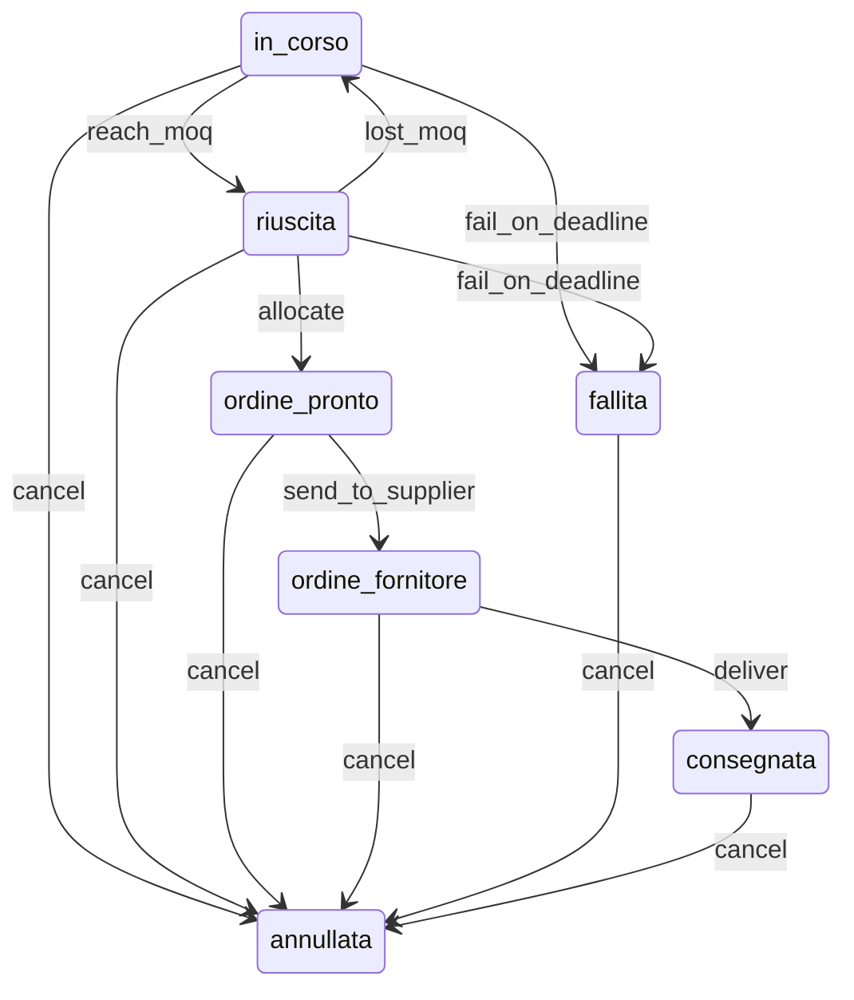

# Campaign workflow

The campaign lifecycle is modelled as a Symfony **state machine** named `campaign`
(`config/packages/workflow.yaml`). It is consumed through
`App\Campaign\Application\CampaignTransitioner` and mirrors the state machine derived from
the legacy implementation (see [ADR 0002](adr/0002-faithful-port.md)).

## States

All seven values of `App\Campaign\Enum\CampaignStatus` are live; no state is deactivated.

| Value | Meaning |
|---|---|
| `in_corso` | Open for participations. |
| `riuscita` | MOQ reached, the campaign has won. |
| `fallita` | Deadline passed below the MOQ. |
| `ordine_pronto` | Quantities allocated, ready to be sent to the supplier. |
| `ordine_fornitore` | Order sent to the supplier. |
| `consegnata` | Order fulfilled and delivered. |
| `annullata` | Cancelled. |

## Transitions

Transition names are English snake_case; the stored status values remain Italian for parity
with the legacy database.

| Transition | From | To | Guard | Business rule |
|---|---|---|---|---|
| `reach_moq` | `in_corso` | `riuscita` | `currentQuantity >= moq` | MOQ reached (payment webhook / recalculation in the legacy code). |
| `fail_on_deadline` | `in_corso`, `riuscita` | `fallita` | deadline passed and quantity below MOQ | Campaign closed below the MOQ. |
| `lost_moq` | `riuscita` | `in_corso` | quantity below MOQ and deadline not passed | Withdrawal after success; parity with the legacy recalculation path. |
| `allocate` | `riuscita` | `ordine_pronto` | — | Admin allocates quantities (idempotent in the legacy code). |
| `send_to_supplier` | `ordine_pronto` | `ordine_fornitore` | — | Admin sends the order; supplier-order creation happens in a later PR. |
| `deliver` | `ordine_fornitore` | `consegnata` | supplier order exists and is fulfilled | A fulfilled supplier order delivers the campaign. |
| `cancel` | all states except `annullata` | `annullata` | — | Admin cancels the campaign. |

A campaign is created directly in `in_corso` by the application, outside the workflow.

## Diagram

## How it is used

- `App\Campaign\Workflow\CampaignGuards` subscribes to `workflow.campaign.guard` and evaluates
  the pure predicates for `reach_moq`, `fail_on_deadline`, `lost_moq` and `deliver`.
- `App\Campaign\Application\CampaignTransitioner` checks `Workflow::can()`, rejects blocked
  transitions with `App\Campaign\Exception\CampaignTransitionNotAllowedException`, stamps
  `statusUpdatedAt` (parity with the legacy "status changed at" field) and dispatches
  `App\Campaign\Event\CampaignStatusChanged` (`from`, `to`, `actorId`, `occurredAt`).
- Unit tests build the same definition from `config/packages/workflow.yaml` through
  `App\Tests\Support\CampaignWorkflowFactory`; the integration test covers persistence and
  container wiring.

## Documented deviations

1. The `deliver` guard resolves the supplier order through `SupplierOrderRepository`, because
   Symfony 7.4 `GuardEvent` carries no context and `Workflow::can()` accepts none.
2. Multi-`from` transitions are expanded into one `Transition` per from→to pair: a state
   machine transition may have a single input. The framework configuration layer and
   `CampaignWorkflowFactory` both perform this expansion.
3. `cancel` is declared explicitly from the six live non-`annullata` states (equivalent to the
   legacy wildcard behaviour).
4. `lost_moq` is included although it is undocumented in the legacy UI, for parity with the
   recalculation path.
5. `CampaignTransitioner` is public in the test environment only (`when@test` in
   `config/services.yaml`) until a controller consumes it.

## Not in this PR

- HTTP endpoints and controllers.
- A scheduler for the deadline-driven transitions; they are pure predicates for now.
- Transition side effects: refunds, MOQ notifications, quantity flips, supplier-order creation,
  idempotency flags — all deferred to later PRs.
- An audit entity; only `statusUpdatedAt` and the domain event are kept.
- Role checks; the legacy code enforced roles at the endpoint level, guards stay pure.

## Proposed improvements (post-parity)

- Unify the tier-threshold and `moq` checks used to determine success.
- Add the payment/order checks the legacy cancel path lacked.
- Replace the repository lookup in the `deliver` guard with guard context if a newer Symfony
  supports it.
