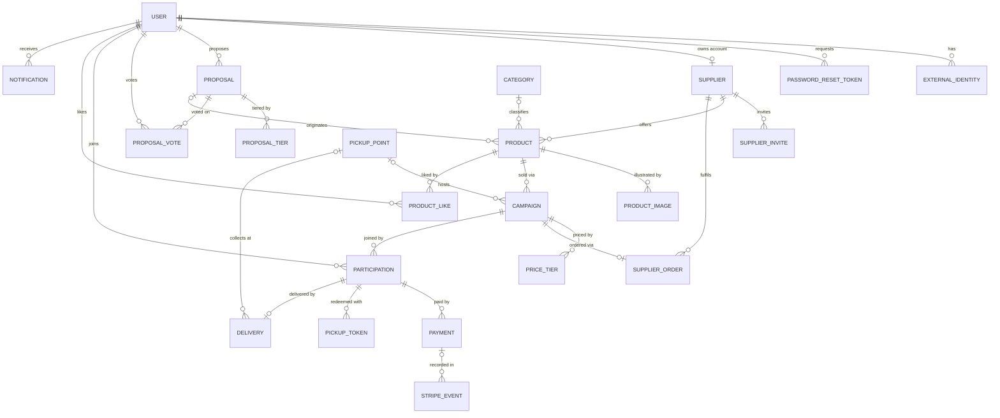

# Domain model

Persistence model for the BuyPool JSON API, derived from the legacy schema
(derived from the legacy schema and the domain analysis of the original project) and reconciled with the domain analysis
(derived from the legacy schema and the domain analysis of the original project). This document is the map of the Doctrine entities,
not a behavioural spec: business rules (pricing, allocation, state transitions) arrive
in later pull requests. See ADR [0001](adr/0001-use-symfony.md) and
[0002](adr/0002-faithful-port.md) for the porting strategy.

## Bounded contexts

Entities live under `src/<Context>/Entity` and are mapped per context
(`App\<Context>\Entity`), configured in `config/packages/doctrine.yaml`:

| Context | Entities | Purpose |
|---|---|---|
| Identity | User, ExternalIdentity, PasswordResetToken | Accounts, OAuth links, password reset. |
| Supplier | Supplier, SupplierInvite, SupplierOrder | Supplier catalogue, activation invites, orders to suppliers. |
| Campaign | Category, Product, ProductImage, Campaign, PriceTier | Catalogue and group-buying campaigns. |
| Participation | Participation | A user's commitment to a campaign. |
| Payment | Payment, StripeEvent | Stripe payments and webhook idempotency. |
| Delivery | PickupPoint, PickupToken, Delivery | Pickup points, QR pickup tokens, home delivery. |
| Proposal | Proposal, ProposalTier, ProposalVote, ProductLike | Community product proposals, votes and likes. |
| Notification | Notification | User notifications. |

## Model diagram

## Entities

### Identity
- **User** — account for customers, suppliers and admins. Single role enum with a derived
  `getRoles()`; `hashedPassword` is nullable (OAuth-only accounts). Personal data (GDPR).
- **ExternalIdentity** — one OAuth link per `(provider, subject)`, replacing the legacy
  `google_id` / `microsoft_id` columns.
- **PasswordResetToken** — single-use reset token, stored as a SHA-256 `tokenHash`.

### Supplier
- **Supplier** — supplier record, optionally linked to a `User` account (`isPublic` drives the catalogue).
- **SupplierInvite** — activation invite, stored as a SHA-256 `tokenHash` with expiry and `usedAt`.
- **SupplierOrder** — 1:1 with a `Campaign`; carries a readable annual `orderNumber` (`YYYY-NNNNNN`) plus `orderYear`.

### Campaign
- **Category** — product classification; unique name.
- **Product** — a supplier product with integer-cent prices and a minimum quantity; optionally
  originated from a `Proposal`.
- **ProductImage** — gallery image with `position` and `isMain`.
- **Campaign** — a group-buying run over a product: MOQ, current quantity, deadline, status,
  commission rate and price tiers.
- **PriceTier** — campaign price by participant threshold; unique per `(campaign, threshold)`.

### Participation
- **Participation** — a user's quantity commitment to a campaign; one per `(campaign, user)`.

### Payment
- **Payment** — a Stripe payment (deposit/balance/delivery) linked to a participation;
  unique `stripePaymentIntentId` for idempotency.
- **StripeEvent** — webhook log keyed by unique `eventId` for idempotency.

### Delivery
- **PickupPoint** — physical pickup location.
- **PickupToken** — QR pickup credential; **many per participation** (partial pickups),
  stored as a SHA-256 `tokenHash`.
- **Delivery** — 1:1 delivery record per participation (`ritiro_sede` or `consegna_domicilio`).

### Proposal
- **Proposal** — community product proposal with a status, cached `votesCount` and optional tiers.
- **ProposalTier** — proposed price by threshold; unique per `UNIQUE(proposal, threshold)`.
- **ProposalVote** — one vote per `(proposal, voter)`.
- **ProductLike** — one like per `(user, product)`.

### Notification
- **Notification** — user notification with a type, optional polymorphic reference and read flag.

## Key choices

- **Identifiers: UUID v7** (`symfony/uid`) as primary keys everywhere, generated in the constructor.
  The only human-readable number is `SupplierOrder.orderNumber`.
- **Money: integer cents** (`*Cents`) plus a `currency` field (default `EUR`). The legacy schema
  used `DECIMAL(10,2)`; conversion is `cents = (int) round(decimal * 100)`. The campaign
  `commissionRate` is a rate, not money, and stays `DECIMAL(5,2)`.
- **States: PHP 8.1 backed enums** mapped in Doctrine (the legacy schema used MySQL `ENUM`).
  Values never written by the legacy code are kept for parity and marked `@deprecated`; they are
  never used in transitions.
- **Tokens: hashed.** Supplier invites, password resets and pickup tokens store only a SHA-256
  `tokenHash`; the plaintext exists only in the delivered link/QR. Pickup tokens rotate on display.
- **No physical deletion of users.** User rows are anonymised instead; business records
  (participations, proposals, votes, notifications) reference the user with `ON DELETE RESTRICT`,
  credentials (`ExternalIdentity`, `PasswordResetToken`) cascade.
- **Invariants in constructors only** (e.g. `quantity > 0`, non-negative amounts, non-empty names);
  no cross-aggregate business logic lives in entities.

## Deviations from the legacy schema

### Removed columns
| Legacy column | Table | Reason |
|---|---|---|
| `num_campagne` | fornitori | Never recomputed (dead denormalisation). |
| `categoria` | fornitori | Not used by the code; reintroduce as a taxonomy if needed. |
| `regola_arrotondamento` | collette | Never read by the code. |
| `payload_json` | eventi_stripe | Contained personal data with no retention policy; `eventId` + `processed` suffice. |
| `proponente_tipo` | proposte_prodotti | Redundant with the proposer's `User.role`. |
| `google_id`, `microsoft_id` | utenti | Replaced by the `ExternalIdentity` entity (one row per provider). |

### Added tables / entities
| New entity | Reason |
|---|---|
| **ProposalTier** | From `proposta_scaglioni`: supplier-entered proposal tiers copied to campaign tiers on publication. |
| **ProductImage** | From `immagini_prodotto`: product gallery (FR-41). |
| **PickupPoint** | From `sedi`: needed for `Campaign.pickupPoint` and `Delivery.pickupPoint` foreign keys. |
| **PasswordResetToken** | From `reset_password`: first-class entity with hashed token. |
| **ExternalIdentity** | Replaces the per-provider columns on `users`; supports an open set of providers. |
| **ProductLike** | Greenfield: no legacy table. The legacy `POST/DELETE /prodotti/{id}/like` route was absent (404) and R9 was never implemented; kept as NEW. |

### Added constraints
| Constraint | Table | Reason |
|---|---|---|
| `UNIQUE(campaign, threshold)` | proposal_tiers | Prevents publication failures when copying tiers. |
| `UNIQUE(provider, subject)` | external_identities | One link per provider identity. |
| `UNIQUE(user, product)` | product_likes | One like per user and product. |
| `UNIQUE(order_number)` + `INDEX(order_year)` | supplier_orders | Readable annual order number. |
| `UNIQUE(stripe_payment_intent_id)` | payments | Idempotent payment handling. |

### Changed relations
- `qr_codes` → **PickupToken** is a **ManyToOne** on participation (no unique): the legacy schema
  had no unique constraint, the domain ER models `prenotazioni ||--o{ qr_codes`, and
  `quantita_assegnata` allows partial pickups.
- `reset_password` and `inviti_fornitore` store a `tokenHash` (SHA-256) instead of the plaintext token.
- `prezzi` are integer cents + `currency` instead of `DECIMAL(10,2)`.

### Deferred
- `recensioni_fornitore` and `recensioni_campagna` (supplier/campaign reviews) are **not** ported in
  this pull request; they will be modelled separately.
